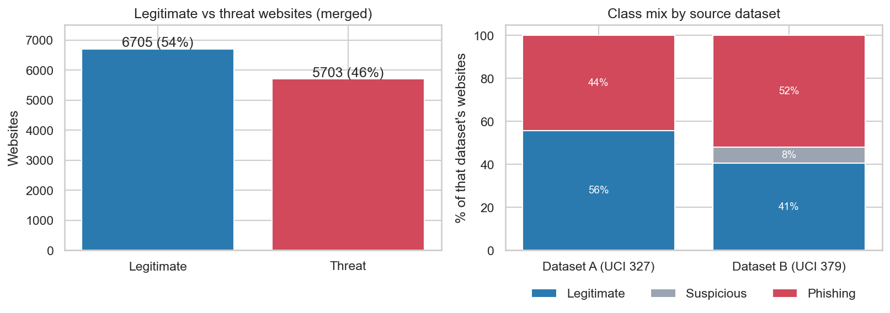
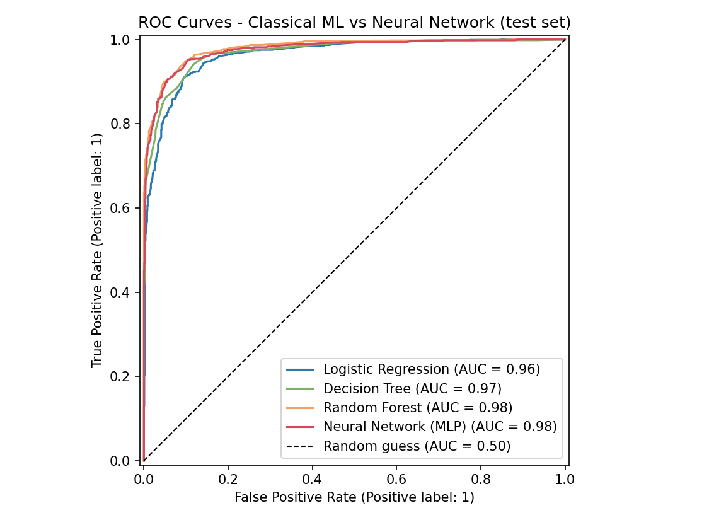
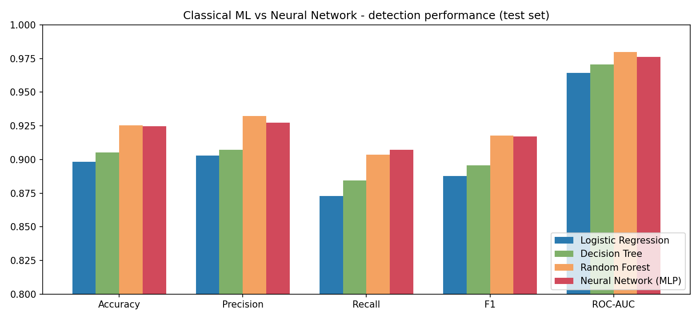
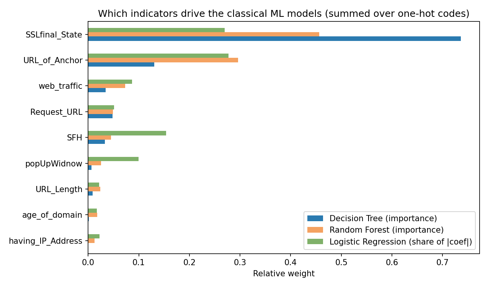

# AI-Driven Cyber Threat Awareness & Phishing Detection Prototype

**Course:** AI in Cyber Security Lab (`ENSP355`) — Unit 1 Capstone Project  
**Author:** Yatharth Chopra (`2301420022`)  
**Program:** B.Tech CSE (Data Science), Semester 7  
**University:** K.R. Mangalam University  
**Submitted to:** Monika Khatkar  
**Repository:** [Ai-In-Cyber-Project-2301420022](https://github.com/yatharthchopra2424/Ai-In-Cyber-Project-2301420022)

---

## 1. Problem Overview & Objectives

Phishing remains one of the most prevalent initial-access vectors in cybersecurity, deceiving users into disclosing credentials on spoofed websites. Static blocklists only catch previously reported domains, whereas supervised Machine Learning and Deep Learning models learn combinations of URL, SSL/TLS, and HTML structural indicators to flag previously unseen threats.

This capstone project implements an end-to-end, reproducible threat detection pipeline across **all five tasks (Tasks 1–5, full 100-mark rubric)**:

1. **Task 1 — Environment Setup & Schema Harmonization:** Validate the Python ML/DL environment, convert two raw UCI `.arff` datasets to `.csv`, perform a row-wise union on their **9 shared attributes**, and resolve a discovered feature-polarity inversion in Dataset B.
2. **Task 2 — Cyber Threat Landscape Analysis (EDA):** Analyse class balance, feature code distributions (`-1 = Phishy`, `0 = Suspicious`, `+1 = Legitimate`), cumulative red-flag risk, Spearman correlation, Mutual Information, and cross-source alignment.
3. **Task 3 — Classical Machine Learning Classification:** Train and evaluate **Logistic Regression**, **Decision Tree** (`max_depth=6`), and **Random Forest** (`n_estimators=200, max_depth=12`) using leak-free `scikit-learn` `Pipeline`s with one-hot encoding.
4. **Task 4 — Deep Learning vs. Classical ML & Validation:** Compare a feed-forward **Neural Network (`MLPClassifier`, 32 → 16, ReLU, Adam, early stopping)** against all three classical models on Accuracy, Precision, Recall, F1, **ROC-AUC**, unseen-profile generalisation, training/prediction latency, 5-split stability (`mean ± std`), and merge/feature-subset sensitivity.
5. **Task 5 — Ethical Reflection & AI Challenges:** Simulate **threshold tuning** (legitimate-user blocking vs. missed threats) and **biased training data** (omitting Dataset B causes accuracy on B to drop from `89.3%` to `76.0%` and FPR to nearly triple from `12.7%` to `34.5%`), and document ethical, privacy, and explainability limitations.

---

## 2. Project Structure

```text
Ai_cyber_capstone/
├── data/
│   ├── raw/
│   │   ├── Training_Dataset.arff          # UCI 327 raw ARFF (11,055 x 31)
│   │   ├── PhishingData.arff              # UCI 379 raw ARFF (1,353 x 10)
│   │   ├── phishing_websites_uci327.csv   # Converted Dataset A
│   │   └── website_phishing_uci379.csv    # Converted Dataset B
│   └── merged_phishing.csv                # Harmonised union (12,408 x 13)
├── notebooks/
│   ├── 01_setup_and_data_pipeline.ipynb   # Task 1 (executed)
│   ├── 02_eda_threat_landscape.ipynb      # Task 2 (executed)
│   ├── 03_ml_classification.ipynb         # Task 3 (executed)
│   ├── 04_dl_vs_ml_comparison.ipynb       # Task 4 (executed)
│   └── 05_ethical_reflection.ipynb        # Task 5 (executed)
├── src/
│   ├── common.py                          # Shared paths, constants, profile helper
│   ├── 00a_arff_to_csv.py                 # ARFF -> CSV parser & assertions
│   ├── 00b_merge_datasets.py              # Row-wise union & polarity harmonisation
│   ├── 01_validate_setup.py               # Environment & data smoke test
│   ├── 02_eda.py                          # EDA plots (01-06) & summary stats
│   ├── preprocessing.py                   # Leak-free OneHotEncoder & stratified split
│   ├── evaluation.py                      # Metrics (Acc, Prec, Rec, F1, ROC-AUC, timing)
│   ├── 03_ml_classification.py            # Classical ML models & plots (07-08)
│   ├── 04_dl_comparison.py                # MLP vs ML, 5-split CV, ROC & plots (09-11, 13)
│   ├── 05_ethical_reflection.py           # Threshold & bias simulations & plots (14-15)
│   ├── validate_merge.py                  # Cross-source transfer & suspicious-row check (plot 12)
│   ├── validate_feature_subset.py         # 6 vs 9 feature sensitivity analysis
│   ├── make_report.py                     # Automated PDF report generator
│   └── make_word_report.py                # Automated Word (.docx) report generator
├── outputs/
│   ├── plots/                             # 13 publication-ready figures + notebook screenshots
│   └── *.csv / *.json / *.txt             # Reproducible metrics & summaries
├── report/
│   ├── Technical_Report.pdf               # Printable PDF technical report
│   └── Capstone_Project_Report_Yatharth_Chopra.docx  # Printable Word report with screenshots
├── tests/
│   └── test_smoke.py                      # Automated pytest pipeline integrity checks
├── requirements.txt
├── run_all.sh                             # Linux/macOS end-to-end runner
└── run_all.ps1                            # Windows PowerShell end-to-end runner
```

---

## 3. Datasets & Schema Harmonization

| Property | Dataset A (UCI 327) | Dataset B (UCI 379) | Merged Dataset |
| :--- | :--- | :--- | :--- |
| **UCI Name** | *Phishing Websites* | *Website Phishing* | Row-wise Union |
| **DOI** | `10.24432/C51W2X` | `10.24432/C5B301` | — |
| **Websites (Rows)** | `11,055` | `1,353` | `12,408` |
| **Original Attributes** | `30` | `9` | `9` shared features |
| **Missing Values** | `0` | `0` | `0` |
| **Classes** | Legitimate (`6,157`), Phishing (`4,898`) | Legitimate (`548`), Phishing (`702`), Suspicious (`103`) | Legitimate (`6,705`, `54.0%`), Threat (`5,703`, `46.0%`) |

### Polarity Inversion Discovery & Fix
Although both UCI pages document `+1 = legitimate`, `0 = suspicious`, `-1 = phishy`, Spearman correlation analysis showed that **8 of the 9 features in Dataset B were coded in the opposite direction** (and `having_IP_Address` used `{0, 1}` instead of `{-1, 1}`). Without harmonisation, cross-source transfer accuracy collapsed to **28.8%–44.8%** (worse than random guessing). After reversing inverted features in Dataset B (`outputs/harmonization_report.csv`), cross-source transfer improved to **63.0%–67.9%**.

---

## 4. Key Results (Test Set & 5-Split Stability)

Because the 9 categorical features yield **1,508 unique profiles** across 12,408 rows (with 184 mixed-label profiles), the theoretical look-up ceiling accuracy on these 9 features is **93.68%**.

| Model | Accuracy | Precision | Recall | F1-Score | ROC-AUC | Acc. (Unseen Profiles) | 5-Split Acc. (`mean ± std`) | Train Time (s) |
| :--- | :---: | :---: | :---: | :---: | :---: | :---: | :---: | :---: |
| **Logistic Regression** | `0.8985` | `0.9030` | `0.8729` | `0.8877` | `0.9643` | `0.7213` | `0.9001 ± 0.0021` | `0.021` |
| **Decision Tree** (`depth=6`) | `0.9053` | `0.9074` | `0.8843` | `0.8957` | `0.9705` | `0.8361` | `0.9060 ± 0.0052` | `0.020` |
| **Random Forest** (`200 trees`) | **`0.9255`** | **`0.9322`** | `0.9036` | **`0.9177`** | **`0.9797`** | `0.8525` | **`0.9242 ± 0.0027`** | `0.296` |
| **Neural Network (MLP 32→16)** | `0.9247` | `0.9274` | **`0.9071`** | `0.9171` | `0.9762` | **`0.8689`** | `0.9178 ± 0.0059` | `0.438` |

### Key Takeaways
- **Top Threat Indicators:** `SSLfinal_State` (Spearman `-0.711`, MI `0.305` nats) and `URL_of_Anchor` (`-0.630`, MI `0.259` nats) dominate both EDA rankings and model feature importances, followed by `web_traffic`, `SFH`, and `Request_URL`.
- **Cumulative Red Flags:** Websites with `0` phishy (`-1`) indicators have a low threat rate, whereas websites with `≥ 7` phishy indicators are virtually **100% threats**.
- **Classical Ensemble vs. Deep Learning:** On this low-dimensional categorical tabular dataset, **Random Forest** achieves the highest 5-split mean accuracy (`92.42%`) and ROC-AUC (`0.9785`) in ~`0.29s`, while the **MLP** achieves the highest single-split recall (`0.9071`) and unseen-profile accuracy (`86.89%`). Both approach the `93.68%` information ceiling.

---

## 5. Visual Highlights

| Class Balance & Source Mix | ROC Curves (ML vs. MLP) |
| :---: | :---: |
|  |  |

| Model Comparison | Feature Importance |
| :---: | :---: |
|  |  |

---

## 6. How to Run

### Setup
```bash
pip install -r requirements.txt
```

### Run End-to-End Pipeline
- **Windows (PowerShell):**
  ```powershell
  .\run_all.ps1
  ```
- **Linux / macOS (Bash):**
  ```bash
  bash run_all.sh
  ```

### Run Smoke Tests
```bash
python -m pytest tests/test_smoke.py -v
```
